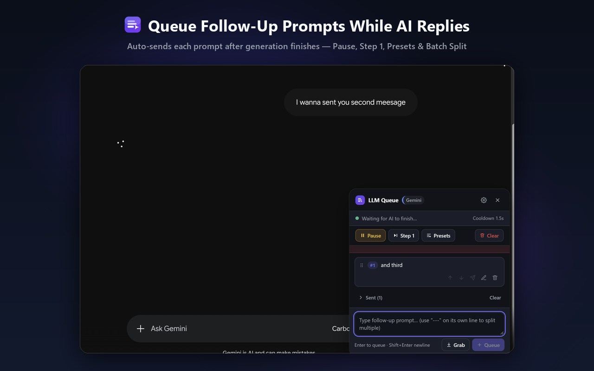
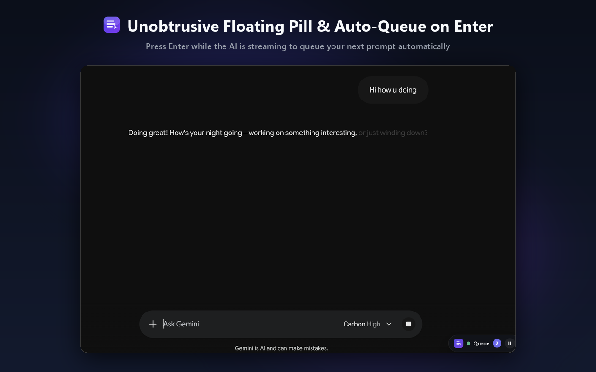

<p align="center">
  
</p>

<h1 align="center">LLM Queue</h1>

<p align="center">
  <strong>Queue and auto-send follow-up prompts effortlessly across ChatGPT, Claude, Gemini, Perplexity, DeepSeek, Grok, and 7+ other AI chat websites.</strong>
</p>

Stop babysitting long AI responses just to paste your next prompt. Write your full chain of follow-up questions ahead of time, hit `Enter` while the AI is still streaming, or paste multi-step workflows separated by `---` — **LLM Queue** watches the page and dispatches each prompt automatically as soon as the previous response completes.

<p align="center">
  
  
</p>

---

## Features

- **Smart Generation Detection & Cooldown**: Automatically detects streaming / Stop-button states and waits through a configurable cooldown (default `1.5s`) before sending the next prompt—resetting safely if the AI resumes tool calls or thinking.
- **Zero-Friction Interception**:
  - Press `Enter` in the site's chat input while the AI is generating to auto-queue instead of waiting or interrupting.
  - Press `Ctrl+Shift+Enter` (`Cmd+Shift+Enter` on Mac) anytime to push your draft directly into the queue.
- **Batch Paste Splitting**: Paste multiple prompts separated by `---` on its own line to enqueue an entire sequence at once.
- **Floating Pill & Shadow DOM Drawer**: Isolated glassmorphic UI that adapts automatically to light/dark themes, with drag-and-drop reordering, inline editing, **Step 1** mode, Pause/Resume, and collapsible sent history.
- **Reusable Prompt Chains (Presets)**: Built-in templates (*Deep Dive & Critique*, *Code Review & Tests*, *Executive Summary & Action Plan*) plus custom presets and JSON backup export/import.
- **Custom & Self-Hosted Sites**: Works on 13 built-in platforms out of the box, plus custom CSS selector rules and one-click **"Enable on this tab"** injection for Open WebUI, LibreChat, Ollama, and internal AI tools.
- **100% Local & Open Source**: Zero telemetry, zero external servers—everything stays in `chrome.storage.local`.

---

## Supported Platforms

| Platform | URLs |
|---|---|
| **ChatGPT** | `chatgpt.com`, `chat.openai.com` |
| **Claude** | `claude.ai` |
| **Google Gemini** | `gemini.google.com` |
| **Perplexity** | `perplexity.ai`, `www.perplexity.ai` |
| **DeepSeek** | `chat.deepseek.com` |
| **Grok** | `grok.com`, `x.com/i/grok` |
| **Le Chat (Mistral)** | `chat.mistral.ai` |
| **Poe** | `poe.com` |
| **Qwen Chat** | `chat.qwen.ai` |
| **Kimi** | `kimi.moonshot.cn`, `kimi.com` |
| **HuggingChat** | `huggingface.co/chat` |
| **Microsoft Copilot** | `copilot.microsoft.com` |
| **OpenRouter Chat** | `openrouter.ai/chat` |
| **Custom / Self-Hosted** | Any site via popup injection or Custom Site Rules |

---

## Keyboard Shortcuts

| Shortcut | Action |
|---|---|
| `Alt + Q` | Toggle the LLM Queue overlay panel |
| `Alt + Shift + P` | Pause or resume auto-dispatching |
| `Ctrl / Cmd + Shift + Enter` | Queue current text from the site's chat box |
| `Enter` *(while AI is busy)* | Auto-queue current text from the site's chat box |

---

## Development & Installation

### Load Unpacked in Chrome (from source)
```bash
git clone https://github.com/ahmetdenizyilmaz/LLM_Queue.git
cd LLM_Queue
npm install
npm run build
```
1. Open `chrome://extensions` in Chrome or Chromium.
2. Enable **Developer mode** (top right).
3. Click **Load unpacked** and select the generated `dist/` folder.

### Scripts
- `npm run build` — Build production bundle into `dist/`
- `npm run watch` — Rebuild automatically on file changes
- `npm run typecheck` — Run strict TypeScript typechecking
- `npm test` — Run Vitest + jsdom unit & engine tests
- `npm run icons` — Regenerate PNG icon assets from `scripts/generate-icons.py`
- `npm run package` — Build and create `release/llm-queue-v<version>.zip` for Chrome Web Store upload

---

## Architecture

```
src/
├── adapters/      # Resilient multi-selector site configs & DOM composer helpers
├── background/    # MV3 service worker (badge counts, commands, custom injection)
├── content/       # Shadow DOM floating pill/drawer UI & keydown interceptor
├── engine/        # MutationObserver + cooldown QueueEngine state machine
├── options/       # Settings, prompt presets, platform toggles & custom rules UI
├── popup/         # Toolbar quick-control popup
└── shared/        # Types, batch parser, conversation scoping & chrome.storage wrapper
```

---

## Contributing & License

Contributions (especially selector updates or new LLM site adapters!) are very welcome. See [CONTRIBUTING.md](CONTRIBUTING.md) for guidelines.

Licensed under the [MIT License](LICENSE).
